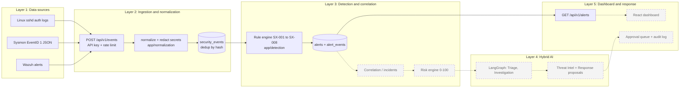
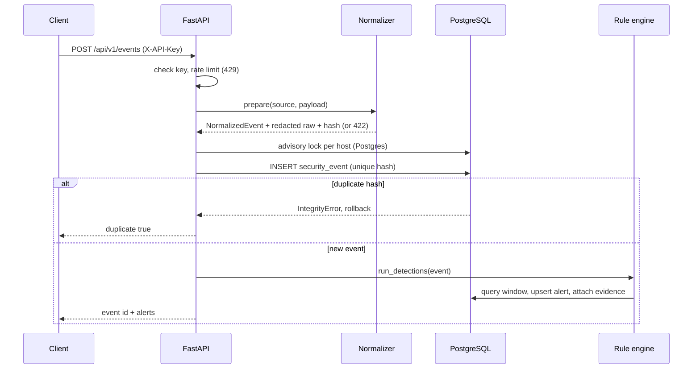

# Architecture

Modular monolith (FastAPI + SQLAlchemy 2 + PostgreSQL). Detection, correlation, risk scoring and authorization are deterministic and work with no LLM. Solid boxes below exist today; dashed boxes are planned (see [checklist.md](checklist.md)).

## Ingest flow (implemented)

## Key decisions
- **Deterministic core.** Rules are Python callables with metadata (id, severity, MITRE, references, enabled). The LLM (M5+) only explains evidence and never changes severity, scores or permissions.
- **Idempotent ingestion.** A SHA-256 of the redacted raw record is unique; resending is a no-op.
- **Concurrency.** On PostgreSQL, ingestion takes a per-host advisory lock so concurrent events see each other (no duplicate alerts, no missed thresholds). Trade-off: per-host serialization.
- **Out-of-order logs.** SX-001 and SX-008 look +-window around each event, so late-arriving events still produce a complete alert.
- **Alert merging.** Alerts for the same (rule, host, group key) merge inside one time window, then a new alert opens. See [detection-rules.md](detection-rules.md).
- **Untrusted input.** Every field is validated or dropped; secrets are redacted before storage; raw size is capped.
- **Shortcuts to revisit:** single shared API key (RBAC in M6), in-memory rate limit (per process), no rule-toggle API (flip `detection_rules.enabled` in SQL), syslog year assumed current UTC year.

## Code map
| Path | Role |
|---|---|
| `backend/app/api/main.py` | routes, auth, security headers, CORS |
| `backend/app/api/ratelimit.py` | per-IP fixed-window limiter |
| `backend/app/core/config.py` | validated settings from `SENTINELX_*` env vars |
| `backend/app/normalization/normalize.py` | parsers, redaction, dedup hash |
| `backend/app/ingestion/service.py` | store + detect orchestration |
| `backend/app/detection/engine.py` | rules and alert upsert |
| `backend/app/database/` | models and session |
