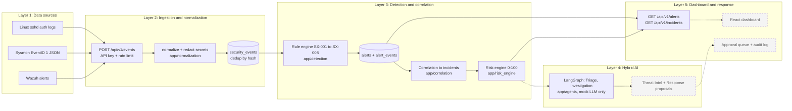
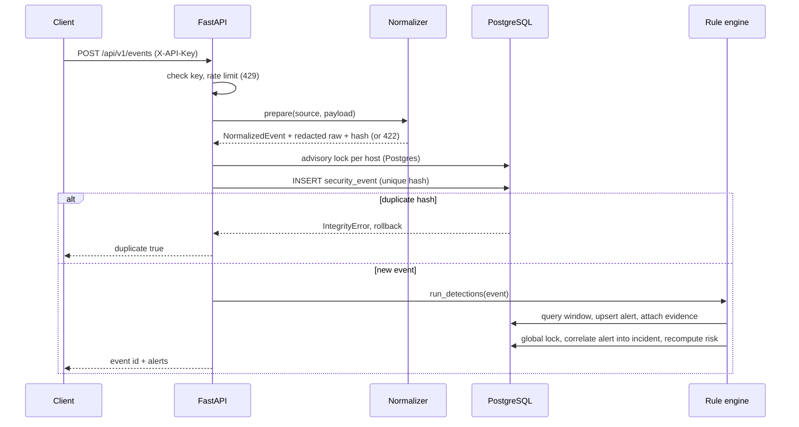

# Architecture

Modular monolith (FastAPI + SQLAlchemy 2 + PostgreSQL). Detection, correlation, risk scoring and authorization are deterministic and work with no LLM. Solid boxes below exist today; dashed boxes are planned (see [checklist.md](checklist.md)).

## Ingest flow (implemented)

## Key decisions
- **Deterministic core.** Rules are Python callables with metadata (id, severity, MITRE, references, enabled). The LLM (M5+) only explains evidence and never changes severity, scores or permissions.
- **Idempotent ingestion.** A SHA-256 of the redacted raw record is unique; resending is a no-op.
- **Concurrency.** On PostgreSQL, ingestion takes a per-host advisory lock so concurrent events see each other (no duplicate alerts, no missed thresholds). Trade-off: per-host serialization.
- **Out-of-order logs.** SX-001 and SX-008 look +-window around each event, so late-arriving events still produce a complete alert.
- **Alert merging.** Alerts for the same (rule, host, group key) merge inside one time window, then a new alert opens. See [detection-rules.md](detection-rules.md).
- **Incidents and risk.** Alerts sharing an entity inside a time window become one incident; a bridging alert merges incidents. A global advisory lock serializes correlation on PostgreSQL. The risk score is a documented weighted formula that renormalizes over missing components. See [correlation-and-risk.md](correlation-and-risk.md).
- **Advisory AI.** A fixed two-node LangGraph explains an incident; it cannot change severity, score or status. Claims need alert/event citations, scope is derived from the incident, tool calls are only audited. See [ai-investigation.md](ai-investigation.md).
- **Authorization.** Every route declares a permission (`require(...)`); people use bearer tokens with four fixed roles, collectors use the shared key with a narrow `service` role; refusals and sensitive operations are audited. See [security-model.md](security-model.md).
- **Untrusted input.** Every field is validated or dropped; secrets are redacted before storage; raw size is capped. Usernames in sshd lines are attacker-controlled, so the line is parsed from its end (the real `from <ip> port N` comes last) and a username containing a fake one cannot change the recorded source IP. Field sizes never decide whether an event is stored: indexed columns are bounded (hostname over 255 chars is rejected with 422, usernames truncated to 255), path columns are unbounded `TEXT`, and a database `DataError` becomes a 422, never a silent 500 that would drop the event.
- **Shortcuts to revisit:** single shared API key (RBAC in M6), in-memory rate limit (per process), no rule-toggle API (flip `detection_rules.enabled` in SQL), syslog year assumed current UTC year.

## Code map
| Path | Role |
|---|---|
| `backend/app/api/main.py` | routes, auth, security headers, CORS |
| `backend/app/api/ratelimit.py` | per-IP fixed-window limiter |
| `backend/app/core/config.py` | validated settings from `SENTINELX_*` env vars |
| `backend/app/normalization/normalize.py` | parsers, redaction, dedup hash |
| `backend/app/ingestion/service.py` | store + detect orchestration |
| `backend/app/detection/engine.py` | rules and alert upsert |
| `backend/app/correlation/engine.py` | entities, incident grouping, merge, backfill |
| `backend/app/risk_engine/score.py` | 0-100 score, weights, missing-data handling |
| `backend/app/api/auth.py` | principals, role permissions, `require()` |
| `backend/app/api/users.py` | login, logout, user management, audit log read |
| `backend/app/api/audit.py` | `audit()` helper (redacted, joins the caller's transaction) |
| `backend/app/core/security.py` | scrypt passwords, session tokens |
| `backend/app/manage.py` | operator CLI (create first admin) |
| `backend/app/api/incidents.py` | incident list, detail and timeline endpoints |
| `backend/app/agents/` | advisory AI: provider seam, Triage → Investigation, citation check, tool-call refusal |
| `backend/app/api/agents.py` | investigate and agent-runs endpoints |
| `backend/app/database/` | models and session |
