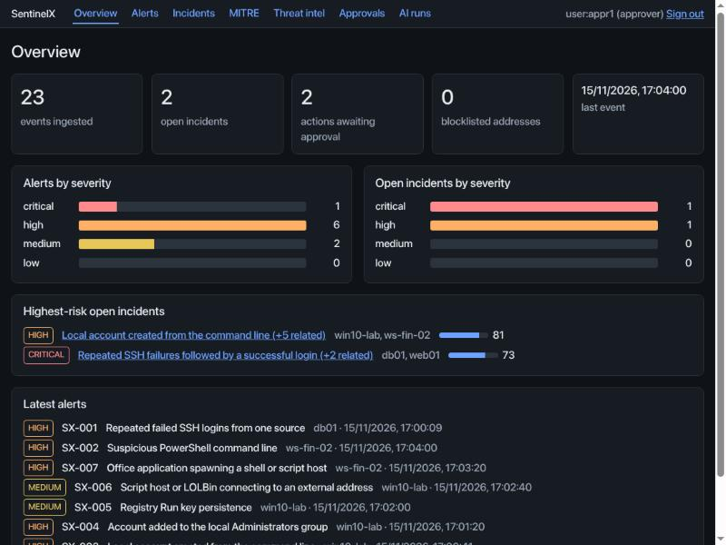
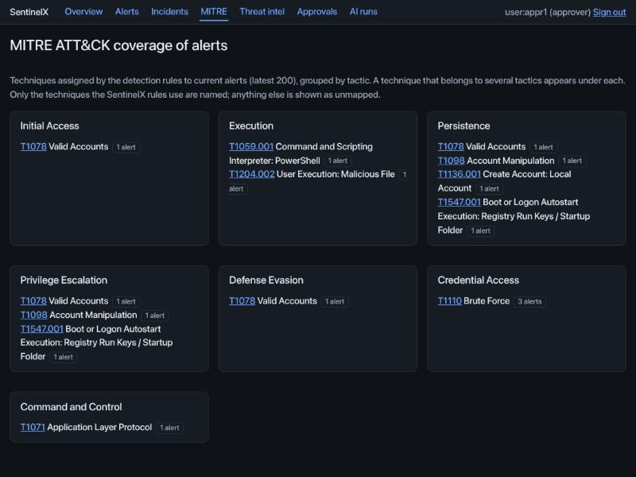

# Dashboard

A React and TypeScript single-page app in `frontend/` (Vite, no UI library, no chart library). In Docker it is served by nginx on <http://localhost:8080>, which also proxies `/api` to the backend, so the browser only ever talks to one origin.

| Overview | Incident detail | MITRE |
|---|---|---|
|  |  |  |

Screenshots show lab data seeded from the test corpus.

## Pages
| Page | What it shows | Needs |
|---|---|---|
| Overview | exact counts (events, open incidents, pending approvals, blocklist), severity bars with the numbers written out, top-risk incidents, latest alerts | read |
| Alerts | filterable table (severity, host, rule), link to the incident | read |
| Incidents, incident detail | ranked by risk; detail has the risk-score breakdown, entities, threat-intel verdicts, alerts with why they were grouped, the evidence timeline with how many alerts cite each event, AI runs, response actions | read |
| MITRE | techniques of current alerts grouped by tactic | read |
| Threat intel | local IOC table, indicator lookup, add or remove IOCs | read; lookup needs `enrich`; IOC writes need `manage_iocs` |
| Approvals | proposals waiting for a decision and the recently decided | read; deciding needs `approve` |
| AI runs | every investigation with model, prompt version, duration, dropped claims, refused tool calls, input hash | read |
| Audit log | filter by action, actor, outcome | `read_audit` (admin) |

## What it does for safety
- **Controls follow permissions.** `/api/v1/auth/me` returns the caller's permissions and the UI hides what they may not do. This is convenience only; the server still enforces every permission, and the 403 is shown if something slips through.
- **Consent before anything leaves the network.** A threat-intel lookup that would contact a provider first shows the server's warning and sends nothing until the person clicks "Send to ...". Cancelling sends nothing.
- **Approving is a dry run unless asked otherwise.** "Run for real" is unticked by default; the server decides whether real actions are allowed. Proposals carry one `Idempotency-Key` per form, so a double click or a retry cannot create two.
- **Log text is data.** Nothing uses `dangerouslySetInnerHTML`; hostile text in a log (``, `<script>`) is rendered as text (tested). A generated report is shown in a `<pre>`, not rendered as markdown.
- **Strict headers.** nginx sends a Content-Security-Policy with no inline script or style and `connect-src 'self'`, plus `nosniff`, `X-Frame-Options: DENY`, no referrer. The page loads and runs with no console errors under it.
- **The session token is in `sessionStorage`** (gone when the tab closes, readable by scripts of this origin). The CSP and React's escaping are the defence. An expired or revoked session returns you to the sign-in page. Moving to an HttpOnly cookie would need backend support.
- **The client address is not spoofable through the dashboard.** nginx *sets* `X-Forwarded-For` to the real peer, so per-IP rate limits and audit rows see the real address (checked: a forged header was ignored). The backend trusts that header from any peer (`FORWARDED_ALLOW_IPS=*`), which is only safe because its port is published on the loopback interface alone; anyone with local access to port 8000 could forge it.

## Run it
```bash
docker compose up --build            # dashboard on http://localhost:8080, API on 127.0.0.1:8000
docker compose exec backend .venv/bin/python -m app.manage create-user alice admin   # first user, see security-model.md
```
Development with hot reload (API on :8000, e.g. from `docker compose up backend db`):
```bash
cd frontend && npm ci && npm run dev    # http://localhost:5173, /api proxied to :8000
```
Checks, also run in CI: `npm run typecheck`, `npm test`, `npm run build`.

## Tests
27 tests (Vitest, Testing Library, a mocked `fetch`) cover the API client (bearer header, 401 handling, idempotency key, error text), the MITRE grouping and the router, and the flows that matter: sign-in and failure, session expiry, what each role is offered, the consent flow, dry run versus real, policy reasons from the server, log text rendered as text, the audit link hidden from non-admins. Each safety property was broken on purpose (11 times) and a test failed every time.

## Limits
- Not tested with a screen reader; the markup uses landmarks, table captions, labelled controls, `aria-current`, `role="alert"` and a skip link, and severity is always written out, but this is not an accessibility audit.
- No ESLint (the project relies on `tsc --strict` and the tests).
- MITRE names exist only for the techniques the rules assign; others show as unmapped. There is no bundled ATT&CK data set.
- Lists are capped (alerts 200, incidents 200, audit 200) with no pagination; the overview counts are exact.
- The overview and lists are loaded on demand: there is no live push, reload the page or revisit it to refresh.
- Timestamps use the browser's locale and time zone.
