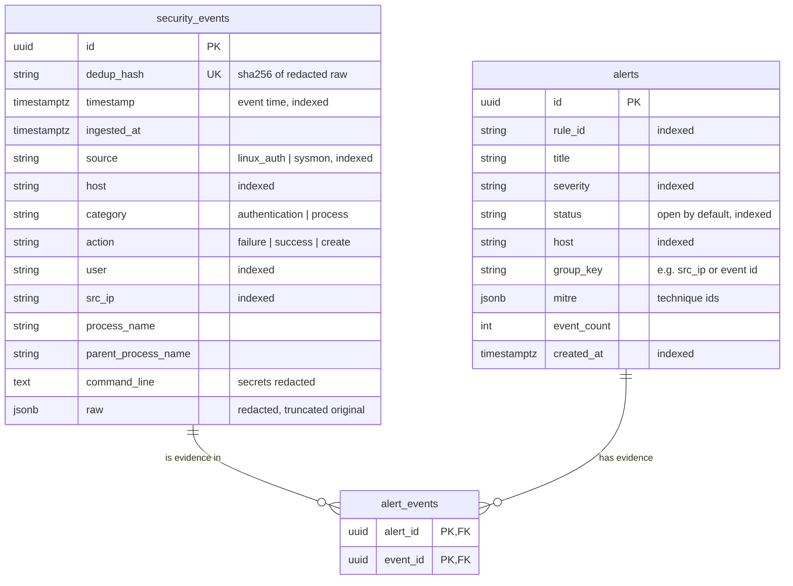

# Database schema

PostgreSQL 17 in Compose; SQLite is used for fast tests only. Tables are currently created with `create_all`; Alembic migrations arrive in Milestone 2 (see [checklist.md](checklist.md)). All timestamps are UTC with time zone. `raw` and `mitre` use JSONB on PostgreSQL (plain JSON on SQLite).



## Constraints and policies
| Table | Constraint | Purpose |
|---|---|---|
| `security_events` | unique `dedup_hash` | idempotent ingestion |
| `alerts` | unique `(rule_id, host, group_key)` | one alert per rule, host and group; later events attach evidence |
| `alert_events` | composite PK, FK to `alerts` (`ON DELETE CASCADE`), FK to `security_events` (`ON DELETE RESTRICT`) | evidence can never silently lose its event |

Events are never deleted by the application. No credentials or API tokens are stored; `redact()` masks `password`, `token`, `api_key` and `secret` values before storage.

## Planned tables (not created yet)
`assets` (M2), `detection_rules` (M2), `incidents`, `incident_alerts`, `incident_evidence` (M4), `agent_runs` (M5), `users`, `roles`, `response_actions`, `audit_logs`, `iocs` (M6).

## Migration workflow (target, from M2)
```bash
cd backend
uv run alembic revision --autogenerate -m "describe change"   # review the generated file
uv run alembic upgrade head
uv run alembic downgrade -1                                    # every migration must be reversible
```
